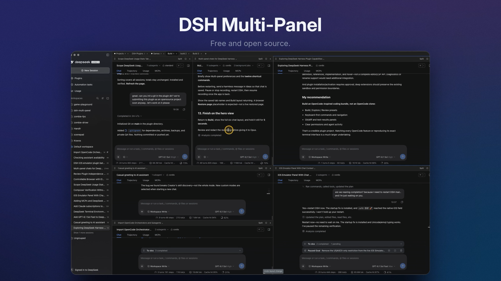
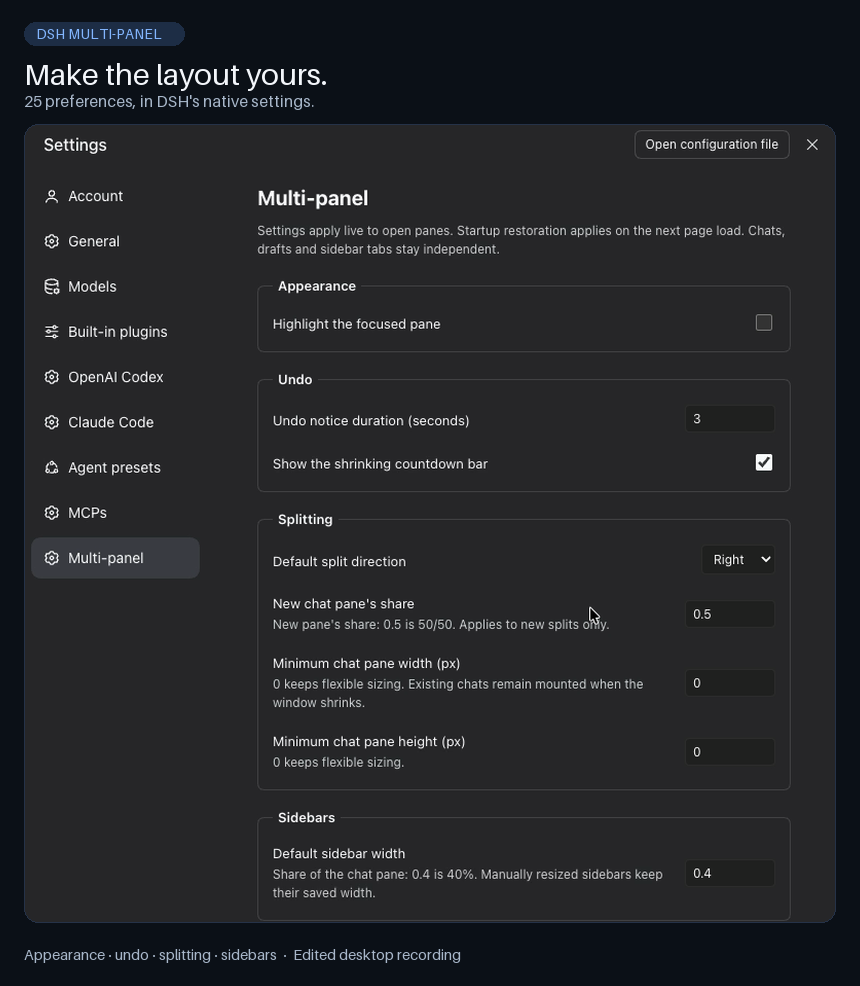
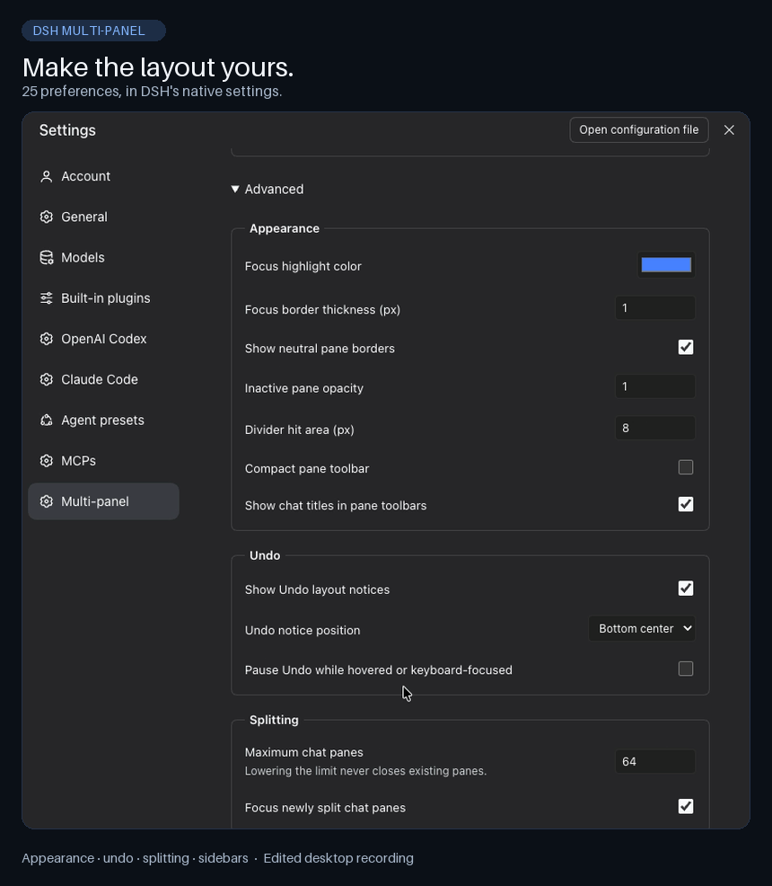

<a id="readme-top"></a>

<div align="center">

# DSH Multi-panel

**Split your workspace. Keep each chat independent.**

Native chat panes and docked sidebar tabs for DeepSeek Harness.


[Install](#install) · [Quick Start](#quick-start) · [Features](#features) · [Demos](#demos) · [Settings](#settings) · [Rollback](#rollback)

</div>

[](docs/media/dsh-multi-panel-v2-16x9.mp4)

<p align="center">
  A 52-second walkthrough: native chat splits, sidebar tools and workspace tabs.<br>
  <a href="docs/media/dsh-multi-panel-v2-16x9.mp4">Watch the 16:9 demo</a> · <a href="docs/media/dsh-multi-panel-v2-16x9.png">Open the still preview</a>
</p>

Keep several chats visible without giving up DSH's native composers, approvals,
Chat/Trajectory/Usage/MCPs views, or sidebar tools. Each pane owns its chat;
one shared session list stays on the left.

> [!WARNING]
> This independent community plugin supports **DSH 0.2.0-rc.2 only**. It replaces
> three native presentation owners: do not re-enable those owners while
> Multi-panel is enabled or bypass compatibility checks. It is not an official
> DeepSeek product.

## Features

| Feature                     | What You Get                                                                             |
| --------------------------- | ---------------------------------------------------------------------------------------- |
| **Split in Any Direction**  | Nest horizontal and vertical chat splits; add an existing chat or a new native session.  |
| **Drag to Arrange**         | Move chats from the session list or pane-title grip onto a pane's edge.                  |
| **Native Chat Tools**       | Keep each chat's composer, approvals, native views, and available agent presets.         |
| **Dock Sidebar Tabs**       | Split a chat's sidebar left, right, above, or below; keep its layout local to that chat. |
| **Targeted File Drops**     | Drop files into the intended chat, with clear pane-specific feedback.                    |
| **Workspace Tabs**          | Keep several pane layouts in tabs; chats in background tabs keep running.                |
| **Layout Controls**         | Resize, maximize, restore, close a pane, or undo a layout change.                        |
| **Remember Your Workspace** | Save layout and widths in this browser; tune 25 profile-wide preferences.                |

## Demos

Start with the full walkthrough above, or explore the earlier feature clips below.
Open an MP4 for the higher-quality video, a GIF for a quick preview, or a still
image for a closer look.

| Demo                     | What the Clip Shows                                                                                                               | Watch or Inspect                                                                                                                 |
| ------------------------ | --------------------------------------------------------------------------------------------------------------------------------- | -------------------------------------------------------------------------------------------------------------------------------- |
| **Full Walkthrough**     | Native chats, split layouts, docked sidebar tools and workspace tabs in a 52-second 16:9 demo.                                    | [MP4](docs/media/dsh-multi-panel-v2-16x9.mp4) · [Still](docs/media/dsh-multi-panel-v2-16x9.png)                                  |
| **Complex Layouts**      | Eight native chat panes and a docked browser; rearrange panes and resize dividers.                                                | [MP4](docs/media/complex-layouts.mp4) · [GIF](docs/media/complex-layouts.gif) · [Still](docs/media/complex-layouts.png)          |
| **Targeted File Drop**   | Preview the target and drop into an unfocused chat; only that chat receives the attachment.                                       | [MP4](docs/media/targeted-file-drop.mp4) · [GIF](docs/media/targeted-file-drop.gif) · [Still](docs/media/targeted-file-drop.png) |
| **Permission Modes**     | One chat changes from Workspace Write to Full Access while another retains Workspace Write.                                       | [MP4](docs/media/permission-modes.mp4) · [GIF](docs/media/permission-modes.gif) · [Still](docs/media/permission-modes.png)       |
| **Sidebar Splits**       | Split browser/terminal tool panes within one chat's sidebar; private tool contents are covered.                                   | [MP4](docs/media/sidebar-splits.mp4) · [GIF](docs/media/sidebar-splits.gif) · [Still](docs/media/sidebar-splits.png)             |
| **Maximize and Restore** | Maximize one chat, then return to the whole layout, with an explicit jump cut.                                                    | [MP4](docs/media/layout-controls.mp4) · [GIF](docs/media/layout-controls.gif) · [Still](docs/media/layout-controls.png)          |
| **Layout Restoration**   | The same eight-chat arrangement before and after an app restart, shown as a before/after cut, not a continuous startup recording. | [MP4](docs/media/layout-restoration.mp4) · [GIF](docs/media/layout-restoration.gif) · [Still](docs/media/layout-restoration.png) |
| **Settings**             | Native preferences and Advanced controls.                                                                                         | [MP4](docs/media/settings.mp4) · [GIF](docs/media/settings.gif) · [Still](docs/media/settings.png)                               |

The earlier feature clips were captured with installed plugin 0.2.6; those clips
do not show workspace tabs (including renaming), divider double-click equalization,
or browser/terminal retention on chat replacement. They also do not show
agent-preset changes, chat close/Undo, or keyboard shortcuts. The supplied full
walkthrough was captured separately; its recorded plugin version is not confirmed.

## Install

**Not published yet.** Version 0.2.7 is the current release candidate, not an npm
release. The package is currently named `dsh-multi-panel`; a scoped npm name
will be confirmed before publication.

For now, build a local tarball and install it through DSH's plugin manager.
A source checkout alone is not installable: it needs artifacts extracted from
the supported desktop application.

**Build prerequisites:** Node.js 22+, pnpm 11.7.0, Python 3, and the supported
DSH desktop installation.

From this repository's root:

```sh
pnpm install --frozen-lockfile --ignore-scripts
python3 scripts/extract-runtime.py --asar "/Applications/DeepSeek Harness.app/Contents/Resources/app.asar"
pnpm pack
```

On another installation, set `--asar` to its application archive. On macOS, the
extractor defaults to the path shown above. Extraction reads selected files into
local `runtime-evidence`; it does not modify DSH. Packaging runs the build, full
tests, and formatting checks. Changed native artifact hashes fail the build's
SHA-256 checks instead of silently producing an incompatible plugin.

1. Open DSH's plugin manager and install the generated, versioned tarball.
2. Enable the `dsh-multi-panel` bundle. It disables only
   `include:ui-conversation`, `include:ui-sidebar-right`, and `include:ui-attachment`,
   leaving exactly one owner for each native slot at startup.
3. Restart DSH, then refresh or reconnect your existing GUI if needed.

Keep other native integrations enabled. For updates, install the exact new
versioned tarball: pnpm may cache repeated local-directory installs.

## Quick Start

1. **Add a pane.** Click **Split**, choose Above/Below/Left/Right, then select
   an existing chat or **New chat**.
2. **Arrange chats.** Drag a session-list chat or pane-title grip onto another
   pane's edge. The highlighted half previews the split; Escape cancels.
3. **Resize and focus.** Drag a divider and click a pane to focus it. Native
   global shortcuts and session-list navigation target the focused pane.
4. **Arrange sidebar tools.** Open the chat's right sidebar. Right-click a tab
   for **Split to left/right/above/below**, or drag it onto a sidebar pane's edge.
5. **Make room.** Use **Maximize**, **Restore**, **Close pane**, or
   **Undo layout change**. Closing a pane does not archive its chat or stop its agent.

Selecting an already visible chat focuses its existing pane. Dragging it moves
that pane rather than duplicating the session: native composer and browser-tab
ownership are session-scoped.

<details>
<summary><b>Everyday Behavior and Layout Limits</b></summary>

- **New chats and agent modes:** New chat creates a distinct native session in
  the originating chat's workspace, never sharing another pane's blank composer.
  In a focused new chat, use the native agent-mode dropdown beside the workspace
  picker to choose Standard, PTC, Creator, or an installed preset before sending.
  Selection belongs to that chat; native Developer tools visibility and
  started-chat restrictions still apply.
- **File intake:** Only the target chat receives dropped files. A light tint
  and **Drop files in this chat** label identify it, even when the normal focus
  highlight is off. There are no file-drop borders. Blocked targets show the
  native unavailable message with an error-colored tint. Feedback follows the
  target, clears on leaving or dropping, and does not change keyboard focus.
  Drops outside chats do not attach files anywhere.
- **Keyboard resizing:** Focus a divider and use the corresponding arrow keys.
  A pane's center is not a split target.
- **Equal sizes:** Double-click a divider to give every pane in that row or
  column the same width or height in one action. A single click does not equalize
  panes. Minimum pane sizes still apply; other rows and columns keep their layouts.
- **Undo:** The notice lasts 3 seconds by default with a shrinking countdown
  bar. Another layout change restarts it; duration and hover/focus pause are configurable.
- **Local sidebar layouts:** Splits, widths, and fullscreen belong to their
  owning chat. Manually resized per-session widths override the default.
- **Sidebar lifetime:** Replacing a chat in the same pane keeps its browser/terminal
  sidebar mounted but hidden behind that pane. Closing the pane or its last retained
  browser/terminal tab releases it; chats without those tabs unload normally.
  Reopening the chat in another pane still reloads its Electron webview. Opening
  it in another workspace tab transfers ownership and removes any hidden sidebar
  copy from the previous tab.
- **Rename workspace tabs:** Double-click a tab name to edit it. Enter or leaving
  the field saves; Escape cancels. An empty name restores the automatic chat title.
  Custom names are saved in this browser's tab index and restored on startup only
  when layout restoration is enabled.
- **Restore:** Invalid, removed, or ephemeral blank chat references return as
  empty panes. Layout and widths are saved in this browser, not across browsers.
- **Bounds:** Safety limits are 64 chat panes, 32 nested split levels, and
  16 docked sidebar panes per chat. Available space and native minimum-size rules
  determine which sidebar splits are possible. Chat minimum sizes default to 0
  for flexible sizing; nonzero values prevent splits that cannot fit and constrain
  divider dragging and keyboard resizing. A shrinking window never destroys
  mounted chats or drafts, and changing limits never closes existing chats.

</details>

## Settings

Open **Settings → Multi-panel** for **25 profile-wide preferences**.
Extra appearance and behavior controls are under **Advanced**.

<table>
  <tr>
    <td width="50%" align="center">
      <a href="docs/media/settings.png"></a><br>
      <b>Main Preferences</b>
    </td>
    <td width="50%" align="center">
      <a href="docs/media/settings-advanced.png"></a><br>
      <b>Advanced Controls</b>
    </td>
  </tr>
</table>

| Group      | Controls                                                                                                                            |
| ---------- | ----------------------------------------------------------------------------------------------------------------------------------- |
| Appearance | Focus highlight (off by default), color/thickness, neutral borders, inactive opacity, divider hit area, compact toolbar and titles. |
| Undo       | Duration (3 seconds by default), countdown bar, position, enable/disable, and hover or keyboard-focus pause.                        |
| Chat Panes | Default split direction, new pane's share (0.5 = 50/50), minimum width/height, pane limit, and whether new panes take focus.        |
| Sidebars   | Default/minimum width, split direction, new pane's share, and per-chat pane limit.                                                  |
| Restore    | Restore the last layout on startup (on by default); changes apply on the next page load.                                            |

Preferences use native DSH Host storage and update open panes without replacing
composers. **Reset multi-panel settings** affects only this plugin's fields,
not native composer or other plugin preferences. Numeric edits save when you
leave the field or press Enter; Escape cancels.

Watch the settings walkthrough in [Demos](#demos).

### Keyboard Shortcuts

Open **Settings → General → Edit shortcuts** and search **Multi-panel**.
All **twelve commands are unbound by default**, preserving your existing keys:

| Layout                            | Navigation and History         | Workspace Tabs                           |
| --------------------------------- | ------------------------------ | ---------------------------------------- |
| Split using the default direction | Focus next pane                | New workspace tab                        |
| Split to the right                | Focus previous pane            | Next workspace tab                       |
| Split below                       | Undo layout change             | Previous workspace tab                   |
| Maximize or restore pane          | Close pane (keep chat running) | Close workspace tab (chats keep running) |

Split commands create a fresh blank native chat. Pane commands do not run while
a settings/dialog modal is open.

## Rollback

1. Disable `dsh-multi-panel`.
2. Re-enable `include:ui-conversation`, `include:ui-sidebar-right`, and `include:ui-attachment`.
3. Restart DSH and reconnect the GUI.

Chats and their logs are untouched. This plugin reads native sidebar persistence
as a fallback but never overwrites that namespace.

## Development

<details>
<summary><b>Build, Verification, and Native Ownership</b></summary>

Use the extraction prerequisites in [Install](#install), then run:

```sh
pnpm run build
pnpm test
pnpm run format:check
```

Without the desktop artifacts, use `pnpm run test:portable` and
`pnpm run format:check`. GitHub Actions runs portable checks; they do not replace
native integration verification. Fresh checkouts require extraction before the
full build/test suite. React is supplied by DSH in production; development
dependencies support the build and tests.

The build embeds narrowly patched native conversation, sidebar, and attachment
owners and an internal all-axis dockkit fork. The docking builtin comes from the
pinned Web shell bundle, not a standalone package artifact. Generated `lib` and
extracted `runtime-evidence` are not committed. The plugin preserves native
services, extension slots, and image rendering; it does not use iframes, edit the
installed desktop application, or run a replacement server. Keep browser
element-context, Usage/MCP dashboards, terminal/files/document providers, and
iOS integration enabled.

**Why panes stay flat:** Split trees describe geometry, not the React hierarchy.
Chat leaves and native dockkit tab hosts stay keyed beneath a stable parent.
Moving, splitting, and resizing change rectangles without remounting editors,
scroll containers, or browser/terminal bodies. An explicit native SessionProvider
resolves each retained session independently of the globally selected chat.

**Verification:** Deterministic Node and React/jsdom checks cover split validation
and operations, session-reference ownership and reentrant navigation, scoped
tabs/drafts, all-axis native sidebar planning, persistence, and stable DOM identity
while moving, resizing, or hiding panes. Manual verification uses the existing GUI
and a task-owned browser session, not an E2E suite. Check native desktop guest
behavior on the actual desktop surface; browser-only tests are not desktop evidence.

See [Contributing](CONTRIBUTING.md) and [Releasing](RELEASING.md) for contribution
boundaries and release checks.

</details>

## Contributing and License

Bug reports should include plugin/DSH versions, operating system, a minimal
reproduction, expected behavior, and actual behavior. Remove private content
from logs and screenshots before sharing. See [Contributing](CONTRIBUTING.md)
and the [Changelog](CHANGELOG.md).

Plugin-authored code is MIT-licensed. Generated bundles include modified native
DSH code and third-party modules under their own notices. Read [LICENSE](LICENSE)
and [Third-Party Notices](THIRD_PARTY_NOTICES.md); preserve bundled notices when redistributing.

<sub>The supplied walkthrough is included unchanged at its owner's request.
Earlier feature clips use opaque editorial covers over private projects, titles,
workspace details, browser content, paths and file previews; benign conversation
text and native controls remain visible. Sensitive desktop and file-picker intervals
are cut from those older clips. See the <a href="docs/media/README.md">media editing and privacy notes</a>.</sub>

[↑ Back to Top](#readme-top)
